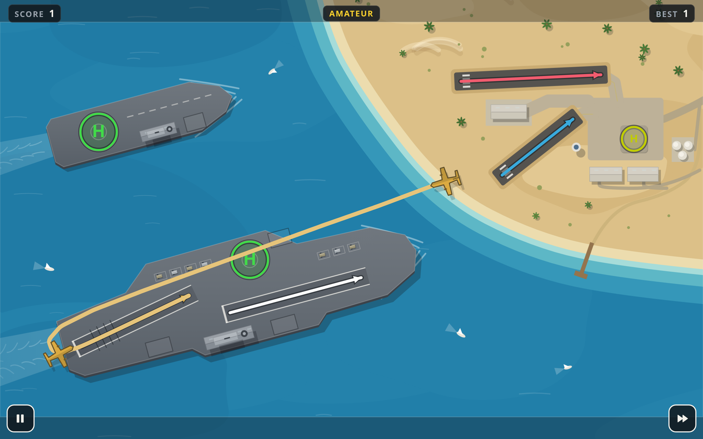

<p align="center">
  
</p>

# Tower Duty

A browser-based air traffic control game. Draw flight paths, guide aircraft to land,
and keep the skies safe. Built with TypeScript, Vite, and Canvas 2D, with offline
support as an installable progressive web app.



## Development

Use Node.js 24 and npm.

```sh
npm ci
npm run dev
```

## Checks

```sh
npm run typecheck
npm test
```

## Production build

```sh
npm run build
```

Serve the generated `dist/` directory with a static web server. Use
`npm run preview` to preview the production build locally. Serve production over
HTTPS for service worker and installation support.

Set `SITE_URL` to the public HTTP(S) URL of the app at build time to generate
canonical and absolute social image URLs. It may include a path, which must end
in `/`, and must contain no query, fragment, or credentials. The build uses
relative URLs, so the app can be served under any path prefix.

## Docker

```sh
docker compose up --build -d
```

The app is served on port 8080 by default. Set `PORT` to change the exposed port.
The image builds the app with Node.js and serves it with nginx. It is not tied
to a URL: set the `SITE_URL` environment variable on the container to the public
URL it is served at (path ending in `/`, letters, digits and `._~:/%+-` only) and
the canonical and social URLs are written into `index.html` at startup.

## Assets

Run `npm run icons` to regenerate the favicons, PWA icons, and social card in
`public/`.

`npm run build` runs `npm run cards`, which renders one link preview image per
map into `public/cards/` (not committed). Each map has a share page at
`m/<map-id>/` that uses its image and redirects into the game. Rendering the
card text needs a sans-serif font installed on the build machine.
